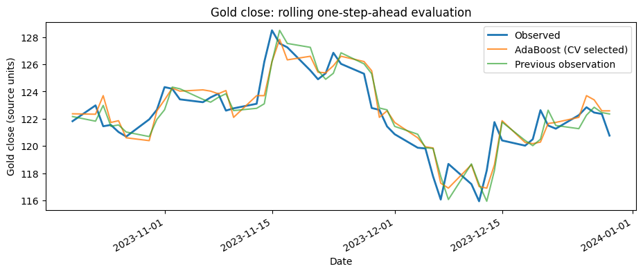
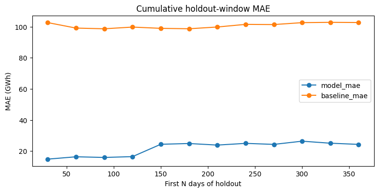

# Gold & Energy Regression | Time-Series ML Experiments

Educational Python/scikit-learn project adapting two regression exercises from an original university notebook. The work compares **Gradient Boosting, AdaBoost and Ridge** on gold-price data and studies how a **Gradient Boosting** electricity-consumption model's error changes as the scored test window grows.

## What this demonstrates

- Time-ordered train/test splits rather than random shuffling.
- Lagged features built strictly from earlier observed values.
- Time-series cross-validation for model selection **on training data only**.
- MAE, RMSE, R², and comparison with a **previous-observation baseline**.
- Reproducible notebook workflows, modular Python code, and tests.

## Notebooks

| Notebook | Dataset | Purpose |
|---|---|---|
| [`gold_regression.ipynb`](notebooks/gold_regression.ipynb) | Gold close prices | Compare three regressors with a naive baseline |
| [`energy_window_analysis.ipynb`](notebooks/energy_window_analysis.ipynb) | German daily electricity consumption | Evaluate error over cumulative test windows of ~30–360 days |

## Saved experiment results

### Gold regression — synthetic demonstration only

The saved notebook uses 260 synthetic rows (253 after lag preparation). AdaBoost was selected by training-only time-series CV.

| Model | CV MAE | Holdout MAE | RMSE | R² |
|---|---:|---:|---:|---:|
| Gradient Boosting | 1.084 | 1.013 | 1.318 | 0.769 |
| AdaBoost | 1.048 | 0.961 | 1.229 | 0.800 |
| Ridge | 1.299 | 1.029 | 1.312 | 0.771 |
| Previous observation | — | 1.045 | 1.336 | 0.763 |



These metrics demonstrate the workflow, not real gold-price predictive performance.

### Electricity consumption — public observational data

The saved run used 3,500 training observations and 876 holdout observations. Gradient Boosting was evaluated on the first 30–360 holdout days. At 360 days, MAE was 24.284 GWh versus 102.713 GWh for the baseline (76.4% lower), RMSE was 41.755 GWh, and R² was 0.930. The model outperformed the baseline across all 12 nested windows. These are rolling one-step predictions, not independent forecast horizons.



## Data provenance

**Gold:** [Financial Data (Kaggle, franciscogcc)](https://www.kaggle.com/datasets/franciscogcc/financial-data). The original CSV used in the coursework is called `financial_regression.csv`; it has **named columns**, including `date` and `gold close`. It is **not** a GLD ETF dataset. The original CSV is **not redistributed** in this repository. Download it from the source and place it at `data/raw/financial_regression.csv`. Without it, the gold notebook automatically uses [`data/sample/synthetic_gold.csv`](data/sample/synthetic_gold.csv), a **clearly synthetic, deterministic demo dataset**. Demo results must not be represented as results on actual gold prices.

**Energy:** [Open Power System Data, Germany daily](https://raw.githubusercontent.com/jenfly/opsd/refs/heads/master/opsd_germany_daily.csv), loaded from its public CSV URL at runtime. An internet connection is needed.

## Run locally

```powershell
py -m venv .venv
.\.venv\Scripts\python.exe -m pip install -r requirements.txt
.\.venv\Scripts\python.exe -m pytest -q
```

Open the `notebooks/` files in VS Code, select the `.venv` Jupyter kernel, and **Run All**. Run from the project root or the `notebooks` folder.

## Methodological notes

The prediction target for the financial experiment is the **`gold close` column** of the supplied financial dataset. The first 80% of usable rows form training data; the last 20% form the holdout. The selected model is chosen via expanding-window CV on training only. Standardization for Ridge is fitted within each CV training fold through a scikit-learn pipeline.

Both experiments are **rolling one-step-ahead evaluations**: predicting an observation using actual preceding observations. In the energy notebook, the '1–12 months' labels refer to progressively longer **evaluation windows**, **not** a genuine forecast made 1–12 months into the future. The windows overlap, so their metrics are not independent.

## Limitations

- Financial time series are nonstationary; a model with high holdout R² may still fail to outperform a naive baseline.
- Model hyperparameters are illustrative, and no financial decision should be based on these experiments.
- The synthetic gold sample demonstrates the code only; evaluate on the source data for meaningful domain conclusions.
- Energy results depend on the availability and version of the external CSV.

## Project layout

```text
images/          Saved experiment figures
notebooks/       Jupyter experiments
src/             Reusable data preparation and evaluation code
tests/           Small regression and leakage checks
data/sample/     Synthetic gold demonstration data
data/raw/        Place downloaded original financial CSV here (gitignored)
```

**Tech:** Python, pandas, NumPy, scikit-learn, Matplotlib, Jupyter, pytest.
